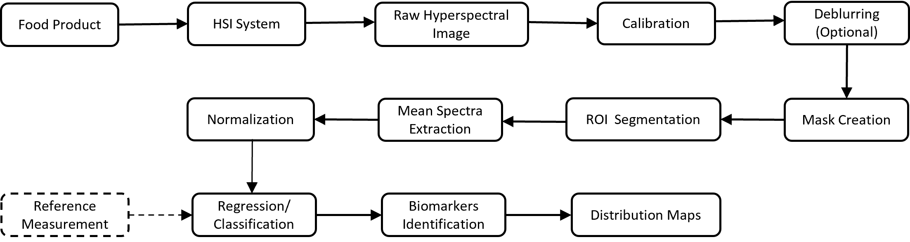
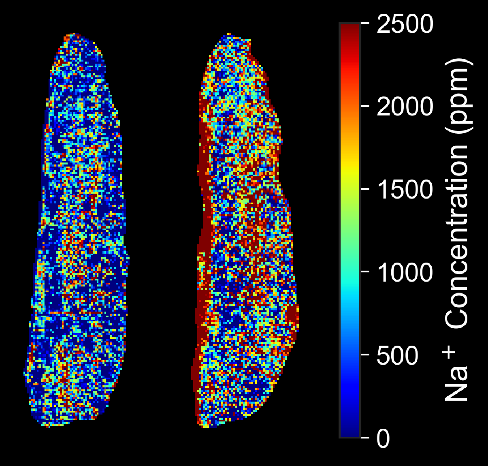

# 🔬 Python HSI Processing Workflow

An open-source Python workflow for end-to-end hyperspectral image (HSI) analysis of food and biological samples — from raw data preprocessing to pixel-level chemical mapping.



## 📖 Overview

This project provides a reproducible, customisable pipeline for processing hyperspectral images in ENVI format. ENVI datasets are typically stored as a text header file (`.hdr`) plus a binary data file (`.raw` or `.dat`). The case study uses two sensors — a **VNIR** (Specim FX10, 400–1000 nm) and a **SWIR** (1000–2500 nm) camera — to map the spatial distribution of macro-components in food samples and other biological samples. Example datasets are provided (salting effects on trout).

The pipeline covers:

- Reflectance computation
- Object detection: single or multiple automatic object detection based on Otsu threshold and other binary mask methods
- Preprocessing: MSC scatter correction, or SNV
- Mean spectra extraction
- Statistical analysis: ANOVA, t-test with FDR and Bonferroni correction
- Machine learning classification (PLS-DA, Random Forest)
- PLSR-based quantitative prediction of analyte concentration
- Pixel-level chemical distribution map generation
- Adaptable to various HSI sensors and spectral ranges

## 📓 Notebooks

The analysis is split into four Jupyter notebooks located in `notebooks/`:

| # | Notebook | Description |
|---|----------|-------------|
| 1 | `1_hsi_processing.ipynb` | Load raw ENVI cubes, compute reflectance, crop and segment samples, apply MSC, extract and export mean spectra |
| 2 | `2_spectral_analysis.ipynb` | Visualise mean spectra, test per-wavelength significance (Welch t-test + FDR), classify with PLS-DA and Random Forest |
| 3 | `3_sodium_prediction.ipynb` | Build and evaluate PLSR models for analyte concentration prediction; compute VIP scores; export trained models |
| 4 | `4_chemical_mapping.ipynb` | Apply trained PLSR models pixel-by-pixel to generate and export chemical distribution maps for each configured sensor |

> **ℹ️ Dataset split:** Notebook 1 demonstrates the preprocessing pipeline on the example HSI samples included in `data/`. Notebooks 2–3 use pre-computed mean spectra (saved in `output/spectra/`) and can be run independently of notebook 1 once those files are available. Notebook 4 requires the raw HSI data, the trained models exported by notebook 3, and the MSC reference spectra from `output/spectra/`.


## 🚀 Getting Started

Python 3.10 or higher is required.

1. Download or clone the repository.
2. Open a terminal in the project folder.
3. Install the required libraries:

```bash
pip install -r requirements.txt
```

4. Open and run the notebooks in order (1 → 4) using JupyterLab, Jupyter Notebook, or VS Code.

## 📁 Folder Structure

```
hsi-processing-python/
├── notebooks/
│   ├── 1_hsi_processing.ipynb
│   ├── 2_spectral_analysis.ipynb
│   ├── 3_sodium_prediction.ipynb
│   └── 4_chemical_mapping.ipynb
│
├── data/
│   ├── VNIR/                             # one subfolder per sample
│   │   └── sample_1/
│   │       └── capture/
│   │           ├── sample_1.hdr/.raw
│   │           ├── WHITEREF_sample_1.hdr/.raw
│   │           └── DARKREF_sample_1.hdr/.raw
│   ├── SWIR/                             # same layout as VNIR
│   │   └── sample_1/
│   │       └── capture/
│   │           └── ...
│   └── measurements/
│       └── measurements_sodium.csv          # lab reference measurements
│
├── output/
│   ├── spectra/                          # output of notebook 1 / input to notebooks 2–4
│   │   ├── vnir_mean_spectra_msc.csv
│   │   ├── vnir_msc_reference_spectra.csv
│   │   ├── swir_mean_spectra_msc.csv
│   │   └── swir_msc_reference_spectra.csv
│   ├── models/                           # output of notebook 3 / input to notebook 4
│   │   ├── vnir_plsr_model.pkl
│   │   └── swir_plsr_model.pkl
│   └── distribution_maps/               # output of notebook 4
│       ├── vnir/
│       │   └── <sample>_distribution_map.png
│       └── swir/
│           └── <sample>_distribution_map.png
│
├── assets/
│   ├── workflow.png
│   └── chemical_map_example.png
│
├── requirements.txt
└── README.md
```

## 🖼️ Example Output



*Sodium (Na⁺) distribution maps of trout samples after 24 h of salting. Red regions indicate high Na⁺ concentration; blue regions indicate low concentration. Left: unsalted control. Right: salted sample.*

## 🤝 Contributing

Contributions are welcome. Please open an issue to discuss proposed changes before submitting a pull request.

## ⚖️ License

### Usage

This software is distributed under the CeCILL v2.1 license (fully compatible with GNU GPLv3). It is freely available for academic research, peer-review, and open-source community use. Under this strict copyleft license, any modified versions or software integrating this code must cite the original work, and be published entirely open-source under the same terms.

### Commercial licensing

For proprietary commercial applications, industrial implementation, or alternative licensing agreements that do not require disclosing your internal software, please contact the authors directly to negotiate a specific commercial license.

**Patent number:** DI-RV-26-0053

## 📚 Citation
If you use this workflow in your research, please cite:

> Lalle, Y., Kominami, Y., & Germond, A. (2026). An open-source python workflow to characterize food samples and food processes by hyperspectral image analysis coupled with machine learning. *LWT, 250*, 119461. https://doi.org/10.1016/j.lwt.2026.119461

BibTeX:

```bibtex
@article{lalle2026hsi,
  author    = {Lalle, Yendoubouam and Kominami, Yuri and Germond, Arno},
  title     = {An open-source python workflow to characterize food samples and food processes by hyperspectral image analysis coupled with machine learning},
  journal   = {LWT},
  year      = {2026},
  volume    = {250},
  pages     = {119461},
  doi       = {10.1016/j.lwt.2026.119461},
  publisher = {Elsevier}
}

